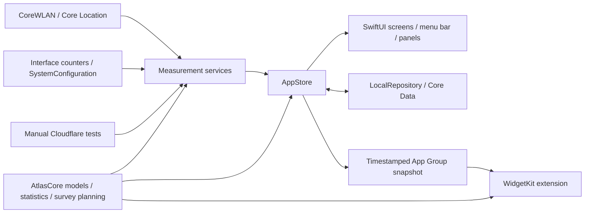

# WiFi Atlas

Native Wi-Fi monitoring, live speed meters, and guided room-by-room heatmaps for **Apple silicon Macs running macOS 14+**. Built with Swift and SwiftUI. Source-available: private noncommercial modifications are free; automatic commercial licensing requires a **25% royalty on gross revenue attributable to the licensed app**, reported and paid within **30 days after each calendar quarter**. Contact **omkasana28@gmail.com** for royalty reporting and payment instructions. See [LICENSE](LICENSE) and the [licensing guide](docs/LICENSING.md) before reuse.

## Commands first

```sh
# Clone, build, and run — no signing account needed for a local build.
git clone https://github.com/omkasana/wifi-atlas.git
cd wifi-atlas
./scripts/build.sh
open "dist/WiFi Atlas.app"

# Run all checks without needing XCTest.
./scripts/test-standalone.sh

# On a Mac with full Xcode selected, run the XCTest suite instead.
./scripts/test.sh
```

Already have a checkout? Save/commit your work first, then update and rebuild:

```sh
git pull --ff-only
./scripts/build.sh
open "dist/WiFi Atlas.app"
```

For private tweaks or contributions under the license:

```sh
git switch -c feature/my-change
# Edit sources, then:
./scripts/test-standalone.sh
./scripts/build.sh
git add <files-you-changed>
git commit -m "Describe your change"
git push -u origin feature/my-change
```

If you do not have push access, fork the repository on GitHub and clone **your fork’s URL** in the first command. Open a pull request to contribute changes back. See [CONTRIBUTING.md](CONTRIBUTING.md).

## Features

| Area | What it does |
| --- | --- |
| Live meters | Friendly Wi-Fi strength score, current download/upload activity, and live graphs |
| Internet tests | Manual Cloudflare download/upload tests with streaming readings, response time, consistency, cancellation, and data/time limits |
| Room planner | Multiple homes/offices/floors, snap-to-grid rooms, router/mesh and door markers, plan imports, undo/redo |
| Guided surveys | Suggested test spots, confirmed stationary captures, pause/resume, skipped spots, and saved progress |
| Heatmaps & reports | Strength/speed/response layers, room rankings, survey comparisons, CSV/PNG/PDF export |
| Wi-Fi information | IP addresses, subnet, router, DNS, DHCP lease, security, generation, adapter, channel, and radio details where macOS exposes them |
| Widgets | Configurable menu bar indicators, resizable floating panels, and an optional WidgetKit extension |
| Native appearance | System/light/dark themes, accents, compact spacing, keyboard-accessible controls, and reduced-motion support |
| Connection tools | On-demand nearby-network scans, optional public-IP lookup, and connection/weak-signal notifications |
| Local history | Core Data storage and migration backups; no account, analytics, or application backend |

Wi-Fi strength, current traffic, and available internet capacity are different measurements. The app labels them separately. Heatmap positions are user-confirmed; shading is estimated from measured spots, not automatic indoor tracking. Internet tests and public-IP lookups contact Cloudflare only when requested. [Usage, privacy, and measurement limits →](docs/USAGE.md)

## Architecture



`AtlasCore` contains models, strength presentation, counters/statistics, interpolation, and survey planning. `WiFiAtlas` contains native screens, hardware/network services, persistence, and application state. The widget extension reads a small shared snapshot rather than accessing the history database or running tests. Protocols separate Wi-Fi monitoring, throughput testing, traffic monitoring, and storage.

[Architecture, data flow, and extension points →](docs/ARCHITECTURE.md)

## Project files

| Path | Purpose |
| --- | --- |
| `Package.swift` | Swift Package targets: core library, native app, and tests |
| `Sources/AtlasCore/Models.swift` | Measurements, layout/survey types, calculations, interpolation, and planning |
| `Sources/WiFiAtlas/WiFiAtlasApp.swift` | App entry point, navigation, dashboard, gauges, settings, history, and menu bar |
| `Sources/WiFiAtlas/AppStore.swift` | Shared observable state, monitoring lifecycle, surveys, alerts, and widget snapshots |
| `Sources/WiFiAtlas/Services.swift` | CoreWLAN/location access, Core Data repository, and streaming speed-test transport |
| `Sources/WiFiAtlas/TrafficService.swift` | Physical-interface byte counters and live activity |
| `Sources/WiFiAtlas/ConnectionInfo*.swift` | Local IP/DNS/DHCP/radio information and its native panel |
| `Sources/WiFiAtlas/SurveyView.swift` | Room planner, guided surveys, heatmaps, comparisons, and exports |
| `Sources/WiFiAtlas/Panels.swift` | Floating windows and menu bar sparklines |
| `Sources/WiFiAtlas/Preview.swift` | Explicit fixture-only visual preview; never normal live data |
| `WidgetExtension/` | Configurable system widgets, metadata, and entitlements |
| `Resources/` | Main app metadata and App Group entitlement template |
| `WiFiAtlas.xcodeproj/` | Generated app/widget Xcode project with shared schemes |
| `Tests/` | XCTest cases and the standalone assertion runner |
| `scripts/` | Build, test, project generation, icon generation, and signed DMG release commands |
| `docs/` | User guide, architecture, and release instructions |
| `DESIGN.md` | Supplied design reference; native UI adapts its visual principles |

## Requirements and development

- Apple silicon Mac, macOS 14+, and a compatible Apple Swift toolchain (Swift 5.9+ language features; recent Xcode/Command Line Tools recommended).
- Python 3 for project generation and build/release helper steps. Check with `python3 --version`.
- No third-party package dependencies. The app uses SwiftUI, Swift Charts, CoreWLAN, Core Location, Network, SystemConfiguration, Core Data, AppKit, PDFKit, and WidgetKit.
- Full Xcode plus an Apple signing team for building/installing system widgets. The default local package build includes menu bar/floating panels and omits the system extension.

```sh
# Select full Xcode when installed.
sudo xcode-select --switch /Applications/Xcode.app/Contents/Developer

# Build a debug app.
CONFIGURATION=debug ./scripts/build.sh

# Open or build the app + system widget extension.
open WiFiAtlas.xcodeproj
DEVELOPMENT_TEAM=YOURTEAMID ./scripts/build-xcode.sh

# After adding/removing app source files, regenerate the Xcode project.
python3 scripts/generate-xcode-project.py
```

The generator owns project settings; update it alongside source changes. Native SwiftPM builds are explicitly selected for compatibility with Command Line Tools installations missing SDK macro plugins. Generated files stay in `.build/` and `dist/`.

Quit a running app before reopening a rebuilt bundle to load the new executable. Never run throughput tests automatically as part of ordinary development checks.

## Tests and current status

The project has **36 automated checks** covering measurement calculations, streaming updates, budgets/deadlines, persistence, migration, surveys, mesh identity, connection-info formatting, and widget snapshot data. Fake transports avoid external network requests. CI builds and runs the checks on an Apple silicon macOS runner; it also type-checks WidgetKit source and validates generated project metadata.

The app is under active development. Local release compilation, ad hoc signature verification, and these checks have passed during development. Full Xcode widget installation, comprehensive hardware/permission/accessibility coverage, and eight-hour resource profiling still need release validation. Performance targets are not benchmark claims. [Release checklist →](docs/RELEASING.md)

## Build a distributable DMG

```sh
# One-time notarization credential setup; prompts securely.
xcrun notarytool store-credentials "wifiatlas-notary"

# Signed/notarized app and DMG, without the system widget extension.
SIGNING_IDENTITY="Developer ID Application: Your Name (TEAMID)" \
NOTARY_PROFILE="wifiatlas-notary" ./scripts/release.sh

# Include system widgets (requires full Xcode and matching signing team).
WITH_WIDGETS=1 DEVELOPMENT_TEAM=YOURTEAMID \
SIGNING_IDENTITY="Developer ID Application: Your Name (TEAMID)" \
NOTARY_PROFILE="wifiatlas-notary" ./scripts/release.sh
```

The resulting file is `dist/WiFiAtlas.dmg`. Publishing is manual; the scripts do not upload releases. Keep certificates, private keys, passwords, and notarization credentials out of Git. [Signing, widgets, and publishing →](docs/RELEASING.md)

## Contributing and licensing

Private noncommercial modifications are free. Commercial use/distribution is automatically licensed while you comply with the **25% gross-attributable-revenue royalty**, notice, and reporting obligations. Written approval is not required; general noncommercial redistribution remains restricted apart from GitHub/contribution exceptions. Reports and payments are due within **30 days after each calendar quarter**. Contact **omkasana28@gmail.com** for reports and payment instructions; this email is not itself advertised as a payment account. See [LICENSE](LICENSE) and the [licensing guide](docs/LICENSING.md). Bug reports and feature suggestions are welcome through [GitHub Issues](https://github.com/omkasana/wifi-atlas/issues). See [contribution guidelines](CONTRIBUTING.md) and [security reporting](SECURITY.md); remove IP addresses, SSIDs, MAC addresses, and floor plans from public diagnostic attachments.

Copyright © 2026 Om Kasana. All rights reserved except as expressly granted by the license. Contributors retain copyright in their original contributions. Apple/macOS/SF Symbols and Cloudflare names refer to their respective owners. WiFi Atlas is an independent project and is not affiliated with or endorsed by Apple, Cloudflare, or Ookla/Speedtest.
